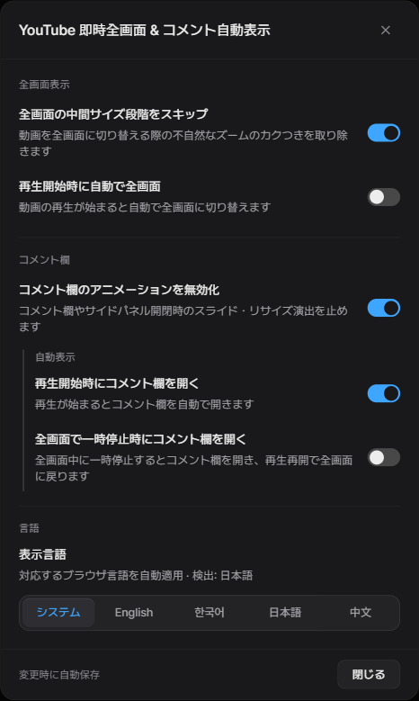

[English](./README.md) · [한국어](./README.ko.md) · **日本語** · [简体中文](./README.zh-CN.md)

# YouTube 即時全画面 & コメント自動表示

**YouTube Instant Fullscreen & Auto Comments**

YouTube の全画面切り替え時に起きる不自然なズームのカクつきをなくし、コメント欄アニメーションの無効化や再生・一時停止に応じたコメント自動表示を行うユーザースクリプトです。

  
  
  

## プレビュー

  

## 主な機能

### 全画面表示

- **全画面の中間サイズ段階をスキップ** (`デフォルト: ON`): 動画を全画面に切り替える際の不自然なズームのカクつきを取り除きます。
- **再生開始時に自動で全画面** (`デフォルト: OFF`): 視聴ページ（`/watch`、`/live/*`）で動画の再生が始まると自動で全画面に切り替えます。再生終了またはリプレイまで動画ごとに 1 回動作します。

### コメント欄

- **コメント欄のアニメーションを無効化** (`デフォルト: ON`): コメント欄やサイドパネルを開閉するときのスライド・リサイズ演出を止めます。
- **再生開始時にコメント欄を開く** (`デフォルト: ON`): 動画の再生が始まるとコメント欄を自動で開きます。すでに全画面表示中の場合は再生画面を狭めないよう、全画面を解除したタイミングで開きます。
- **全画面で一時停止時にコメント欄を開く** (`デフォルト: OFF`): 全画面中に動画を止めるとコメント欄を表示し、再生を再開すると全画面へ戻ります。通常のプレーヤー全画面では一度全画面を解除して下部のコメント欄を表示し、中間サイズ段階スキップをオフにしている場合は全画面のまま右側のサイドパネルで開きます。

### 設定画面と言語

- 拡張機能メニューの **設定** からいつでも各オプションを切り替えられ、変更内容はすぐに保存・反映されます。
- YouTube のライト/ダークテーマに自動で追従します。ブラウザ言語から日本語・英語・韓国語・中国語を自動選択し（未対応言語は英語が既定）、モーダル内のボタンで `システム` / `English` / `한국어` / `日本語` / `中文` を即座に切り替えられます。

## インストール方法

1. ブラウザに [Tampermonkey](https://www.tampermonkey.net/) または [Violentmonkey](https://violentmonkey.github.io/) をインストールします。
2. 下の **Install UserScript** ボタンをクリックしてスクリプトをインストールします:

   

     
   

3. 拡張機能の確認画面で **インストール** を押し、YouTube のタブを再読み込みします。
4. ブラウザの拡張機能アイコンから **設定** を開いて好みに合わせて調整してください。

手動インストールと自動更新について

- ワンクリックインストール画面が開かない場合は、[`youtube-instant-fullscreen-and-auto-comments.user.js`](./youtube-instant-fullscreen-and-auto-comments.user.js) の内容をコピーして拡張機能の新規スクリプトに貼り付けて保存してください。
- ヘッダーに `@updateURL` と `@downloadURL` を設定しているため、今後のアップデートは拡張機能側から自動確認されます。

## 技術仕様と互換性メモ

- `@run-at document-start` で実行し、プレーヤーの初期化前に `ytcfg` とプレーヤー起動設定の `external_fullscreen`・`externalFullscreen` を無効化することで、`<html>` のリサイズ段階を経ずに `#movie_player` のみを直接全画面化します。
- `window.matchMedia` の `prefers-reduced-motion: reduce` 判定を真として返し、`watch-flexy`・`watch-grid`・`watch-learning-journey` 各パネルの CSS トランジションおよびアニメーション時間を `0.001ms` に上書きします。`0s` にすると YouTube 内部の `transitionend`・`animationend` コールバックが完了しなくなるため、`0.001ms` を使用しています。
- 自動全画面はブラウザの `navigator.userActivation` 制限に従うため、クリックやキー操作のあとに再生が始まったときに動作します。再生時のコメント自動表示はブラウザ初回起動や SPA 遷移（`yt-page-data-updated`・`yt-navigate-finish`）を追跡して段階的に再試行し、全画面一時停止の検出は `30ms` デバウンスによってキュー切り替えや再生終了時の擬似 pause（`playerState` `5`・`0`）を除外します。
- スタイルと設定 UI は `innerHTML` を使わず DOM API と `textContent` のみで生成しているため、YouTube の Trusted Types CSP 環境でもブロックされません。

## ライセンス

[MIT License](./LICENSE) の下で公開されています。
