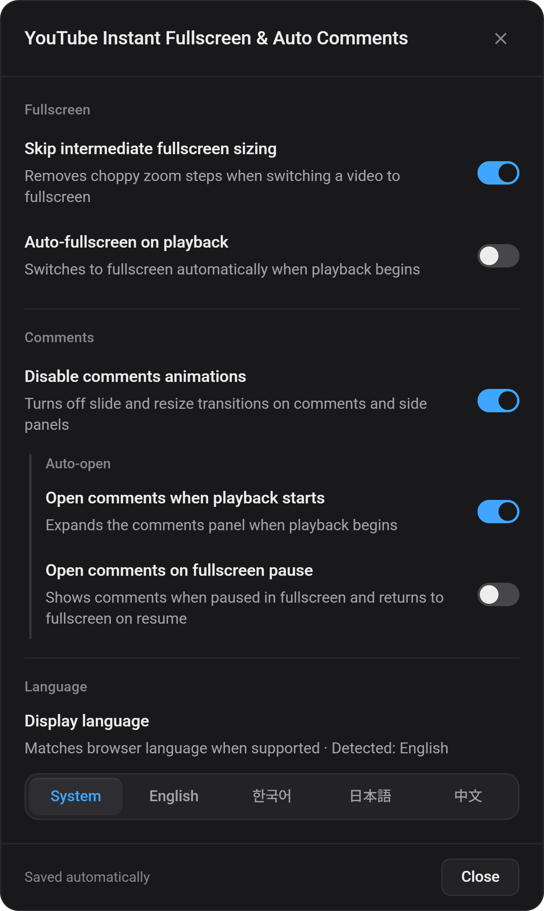

**🇺🇸 English** · [🇰🇷 한국어](./README.ko.md) · [🇯🇵 日本語](./README.ja.md) · [🇨🇳 简体中文](./README.zh-CN.md)

# YouTube Instant Fullscreen & Auto Comments

A userscript that fixes choppy fullscreen zoom transitions on YouTube, disables comments animations, and opens comments automatically when playback starts or when you pause in fullscreen.

  
  
  

## Preview

  

## Features

### Fullscreen

- **Skip intermediate fullscreen sizing** (`Default: ON`): Removes the choppy zoom stutter when switching a video to fullscreen.
- **Auto-fullscreen on playback** (`Default: OFF`): Switches to fullscreen automatically when playback starts on watch and live pages. It runs once per video until playback ends or replays.

### Comments

- **Disable comments animations** (`Default: ON`): Turns off slide and resize transitions when opening or closing comments and side panels.
- **Open comments when playback starts** (`Default: ON`): Opens the comments panel automatically when playback begins. If you are already in fullscreen, comments wait until you exit fullscreen so the side panel does not shrink the video.
- **Open comments on fullscreen pause** (`Default: OFF`): Shows comments when you pause in fullscreen and returns to fullscreen when playback resumes. In normal player fullscreen it leaves fullscreen briefly to show comments below; if intermediate sizing removal is off, it opens the side panel inside fullscreen.

### Settings & Language

- Open **Settings** from your userscript manager menu at any time. Changes save and apply right away.
- The modal matches YouTube's light and dark themes and picks English, Korean, Japanese, or Chinese based on your browser language (defaulting to English for other languages). You can also switch live between `System`, `English`, `한국어`, `日本語`, and `中文`.

## Installation

1. Install [Tampermonkey](https://www.tampermonkey.net/) or [Violentmonkey](https://violentmonkey.github.io/) in your browser.
2. Click **Install UserScript** below and confirm the prompt:

   

     
   

3. Reload YouTube, then open **Settings** from your extension menu whenever you want to adjust options.

Manual installation and updates

- If the one-click install prompt does not open, copy [`youtube-instant-fullscreen-and-auto-comments.user.js`](./youtube-instant-fullscreen-and-auto-comments.user.js) and paste it into a new script in your userscript manager.
- Updates are handled automatically through `@updateURL` and `@downloadURL`.

## Technical & Compatibility Notes

- Runs at `@run-at document-start` to disable `external_fullscreen` and `externalFullscreen` in `ytcfg` and player startup configs before initialization, so `#movie_player` enters fullscreen directly without resizing `<html>`.
- Reports `prefers-reduced-motion: reduce` as true via `window.matchMedia` and overrides CSS transition and animation durations to `0.001ms` across `watch-flexy`, `watch-grid`, and `watch-learning-journey` panels so YouTube's `transitionend` and `animationend` listeners do not stall as they would at `0s`.
- `autoFullscreenOnPlay` follows browser `navigator.userActivation` rules, so auto-fullscreen triggers only after a click or key interaction. Comment auto-opening tracks cold browser loads and YouTube SPA transitions through `yt-page-data-updated` and `yt-navigate-finish` retries, while fullscreen pause detection uses a `30ms` debounce and ignores synthetic queue or end pauses (`playerState` `5` and `0`).
- Builds styles and UI nodes with DOM APIs and `textContent` without `innerHTML`, so YouTube's Trusted Types CSP does not block it.

## License

Released under the [MIT License](./LICENSE).
