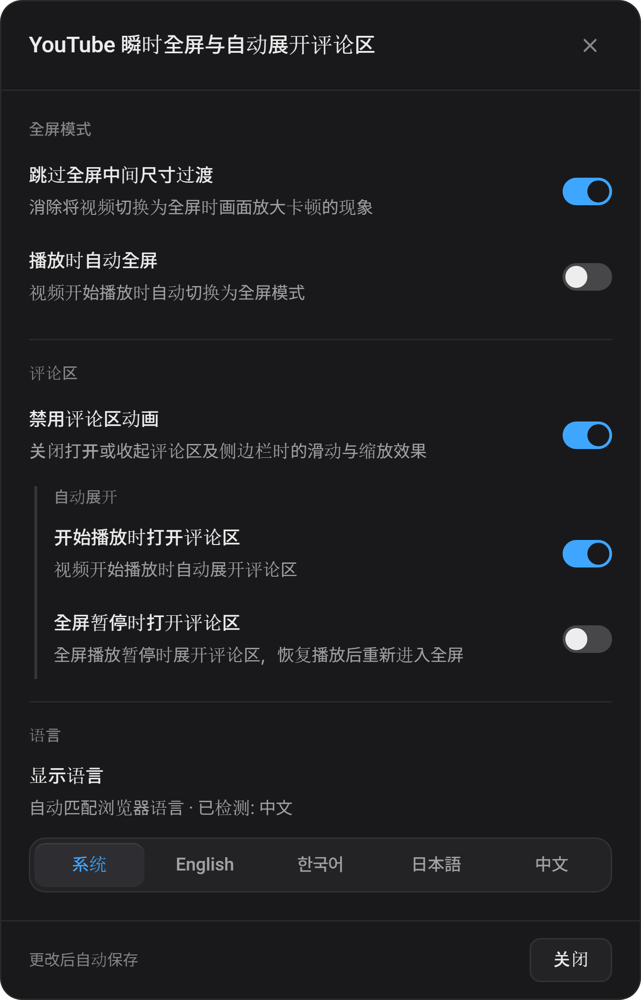

[🇺🇸 English](./README.md) · [🇰🇷 한국어](./README.ko.md) · [🇯🇵 日本語](./README.ja.md) · **🇨🇳 简体中文**

# YouTube 瞬时全屏与自动展开评论区

**YouTube Instant Fullscreen & Auto Comments**

用于消除 YouTube 切换全屏时画面放大卡顿的现象、关闭评论区动画，并在视频开始播放或全屏暂停时自动展开评论区的用户脚本。

  
  
  

## 预览

  

## 功能特性

### 全屏模式

- **跳过全屏中间尺寸过渡** (`默认开启`): 消除将视频切换为全屏时画面放大卡顿的现象。
- **播放时自动全屏** (`默认关闭`): 在播放页（`/watch`、`/live/*`）视频开始播放时自动切换为全屏模式。每个视频触发一次，播放结束或重播后会重置。

### 评论区

- **禁用评论区动画** (`默认开启`): 关闭打开或收起评论区及侧边栏时的滑动与缩放效果。
- **开始播放时打开评论区** (`默认开启`): 视频开始播放时自动展开评论区。若此时已处于全屏状态，会等待退出全屏后再打开，以免侧边栏挤压播放画面。
- **全屏暂停时打开评论区** (`默认关闭`): 全屏播放时暂停视频会自动显示评论区，恢复播放后重新回到全屏。在默认播放器全屏下会暂时退出全屏并在下方展示评论；若关闭了"跳过全屏中间尺寸过渡"，则会保持全屏并在右侧边栏打开评论区。

### 设置界面与语言

- 随时可在扩展菜单的 **设置** 中开关各项功能，所有更改会立即保存并生效。
- 设置弹窗会自动适配 YouTube 的浅色与深色主题，并根据浏览器语言自动切换中文、英语、韩语或日语（其他语言默认使用英语），也可在弹窗内实时切换 `系统`、`English`、`한국어`、`日本語`、`中文`。

## 安装方法

1. 在浏览器中安装 [Tampermonkey](https://www.tampermonkey.net/) 或 [Violentmonkey](https://violentmonkey.github.io/)。
2. 点击下方的 **Install UserScript** 按钮安装脚本：

   

     
   

3. 在弹出的安装确认页面点击 **安装**，随后刷新 YouTube 页面即可使用。
4. 点击扩展菜单中的 **设置** 即可按需调整各个选项。

手动安装与自动更新说明

- 如果一键安装窗口未自动弹出，可复制 [`youtube-instant-fullscreen-and-auto-comments.user.js`](./youtube-instant-fullscreen-and-auto-comments.user.js) 的全部内容，在脚本管理器中新建脚本并粘贴保存。
- 脚本头部已配置 `@updateURL` 与 `@downloadURL`，后续发布新版本时扩展会自动检查更新。

## 技术与兼容性说明

- 在 `@run-at document-start` 阶段运行，在播放器初始化前禁用 `ytcfg` 与播放器配置中的 `external_fullscreen` 和 `externalFullscreen`，让 `#movie_player` 直接进入全屏而无需经过 `<html>` 尺寸过渡。
- 通过 `window.matchMedia` 使 `prefers-reduced-motion: reduce` 返回真值，并将 `watch-flexy`、`watch-grid` 和 `watch-learning-journey` 面板的 CSS 过渡与动画时长覆盖为 `0.001ms`；不使用 `0s`，以免 YouTube 内部的 `transitionend` 和 `animationend` 回调卡住无法触发。
- 自动全屏遵循浏览器的 `navigator.userActivation` 限制，仅在用户点击或按键交互后触发播放时生效。自动打开评论区通过监听 `yt-page-data-updated` 与 `yt-navigate-finish` 并配合阶梯重试来适配冷启动和 SPA 切页；全屏暂停检测采用 `30ms` 防抖，并会过滤切歌队列与播放结束时产生的伪暂停状态（`playerState` `5` 和 `0`）。
- 样式与设置界面采用原生 DOM API 和 `textContent` 构建，不使用 `innerHTML`，可正常通过 YouTube 的 Trusted Types CSP 校验。

## 开源协议

基于 [MIT License](./LICENSE) 发布。
